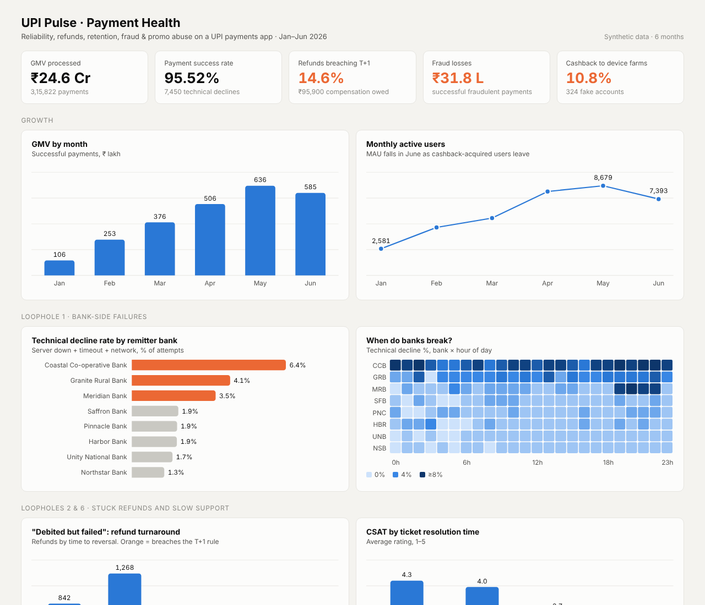

# DhanDrishti: Payment Reliability, Fraud & Retention Analytics

**An end-to-end analytics project on a UPI payments app: where it loses money, users and trust, and what to fix first.**

`SQL` · `Python (pandas, NumPy)` · `scikit-learn` · `Data visualisation` · `Cohort analysis` · `Fraud ML` · `Churn ML`



---

## The business problem

UPI P2P payments carry zero MDR, so a UPI app earns almost nothing per transaction. It grows only if
**payments just work**, **users stay after the cashback ends**, and **losses (fraud, promo abuse, compensation)
stay under control**. This project analyses six months of activity on a fictional UPI app
(**3.16 lakh payments · 12.4k users · 2,000 merchants · 8 partner banks**) to find the six biggest leaks
and size each one in rupees.

> **About the data:** it is synthetic and generated by [`data/generate_data.py`](data/generate_data.py).
> The behaviours built into it come from publicly reported UPI pain points (bank-side declines, the RBI
> T+1 refund rule, collect-request scams, cashback farming). The analysis doesn't know the generator's
> parameters: every pattern below is *found* with SQL/Python, and the hidden ground-truth labels in
> `data/ground_truth/` are only used to check whether the detection worked.

## Key findings

| # | Loophole | What the data shows | Impact (6 months) |
|---|---|---|---|
| 1 | **Bank-side failures** | 3 remitter banks carry **25% of traffic but 47% of technical declines**. Meridian Bank goes from **1.9% to 6.9%** declines at 19:00–23:00. Only **51%** of users recover by retrying within 30 minutes. | **₹31 lakh GMV abandoned** |
| 2 | **"Debited but failed" refunds** | **14.6%** of auto-reversals miss the RBI **T+1** deadline; the same 3 banks breach **24–30%** of the time vs **2–3%** for the rest. | **₹95,900 compensation owed** (₹100/day rule) + 48% of all support tickets |
| 3 | **Cashback buys installs, not users** | Cashback-acquired users churn at **65%** vs **34% organic / 31% referral**. A technical failure in the first 14 days raises churn from **44% → 54%**. | NEWUSER50 cost **₹192 per retained user** vs ₹45 per install |
| 4 | **Fraud** | **Collect-request scams** have a **2.2%** fraud rate (≈8× P2P). Users **45+** are defrauded at **~3.5×** the rate of under-35s. The static risk rules catch only **18%** of fraud, and **69%** of what they block is a legit payment. | **₹31.8 lakh fraud loss** |
| 5 | **Promo abuse (device farms)** | **42 devices** created **324 accounts** (each farm's accounts created within 10 hours) to claim sign-up cashback, then swept it to one master account. | **10.8% of all cashback** leaked |
| 6 | **Slow grievance redressal** | CSAT drops from **4.3** (resolved ≤12h) to **1.2** (>5 days); fraud reports take ~6.5 days to resolve. | 98% detractors in the >5-day bucket |

## Machine learning

### 1 · Real-time fraud scoring ([notebook 02](notebooks/02_fraud_detection_model.ipynb))
- **25 leak-free features** built only from information available *before* each payment: amount vs the user's own
  history, payee's distinct payers so far, payee account age and KYC tier, new device, velocity in the last 1h/24h,
  round amounts, collect-request flag… (tested: deleting all future rows leaves every feature value unchanged)
- **Time-based split** (train Jan–Apr → test May–Jun), not a random split. The test set is used **once**.
- **Model selection by rolling time-series CV** (Feb / Mar / Apr folds). With only ~240 training frauds, a blend of
  logistic regression + a shallow gradient-boosting model beat either alone on every fold (`src/models.py`).
- Evaluated with **PR-AUC**, because fraud is 0.23% of traffic and accuracy is meaningless here.
- Operating threshold picked on **April validation** by net ₹ saved (fraud stopped minus ₹100 friction per false
  flag), then frozen. It is not tuned on the test set.

| May–Jun test (unseen) | Frauds caught (of 504) | Legit flagged | Precision | Recall | Fraud value stopped |
|---|---|---|---|---|---|
| Static rules (current) | 135 | 250 | 35% | 27% | ₹10.8 lakh |
| **Model, same 385 flags as the rules** | **267** | 118 | **69%** | 53% | ₹17.2 lakh |
| **Model at frozen validation threshold** | **335** | 367 | 48% | **66%** | **₹20.8 lakh** |

Test PR-AUC: **0.63** for the blend vs 0.60 (logistic regression) and 0.56 (gradient boosting). The model catches
**71% of collect-request scams, which the rules miss completely**. Its weak spot is fake-merchant QR fraud (34% recall),
so merchant-side features are the next thing to add.

### 2 · Early churn prediction ([notebook 03](notebooks/03_churn_prediction.ipynb))
- From a user's **first 30 days**, predict **zero payments in days 31–60**.
- Gradient boosting **ROC-AUC 0.89**; an interpretable logistic regression (0.87) explains *why*: inactivity,
  cashback-only acquisition, early technical failures and refund breaches raise risk; organic/referral and habit
  (more active days, merchant payments) lower it.
- **The top 3 risk deciles (30% of users) contain 75% of churners**, so the retention team can work a short list instead of paying blanket cashback.

## Recommendations

1. **Bank health routing.** Monitor decline rate per bank per 15 minutes. When a remitter bank degrades, prompt users to
   switch to a linked secondary account *before* they pay. Use the bank × hour heatmap to negotiate SLAs with the 3 worst banks.
2. **Refund TAT watchdog.** Daily alert on debits approaching T+1, proactive in-app "your ₹X is on its way" updates
   (refund tickets are the #1 ticket category), and escalation with the 3 banks that own 96% of the compensation liability.
3. **Pay cashback on the 3rd transaction, not the 1st**, and protect a new user's first week (route around unhealthy banks).
   That attacks both farm abuse and one-and-done churn.
4. **Replace the static rules with the risk score + step-up actions**: full-screen *"You are about to SEND ₹X"* warnings on
   risky collect requests, a cooling-off period for large first-time transfers from new devices, and blocklisting of mule
   accounts (many unrelated payers + fast pass-through, see `sql/05`).
5. **Device-graph rule at sign-up:** at most 2 reward-eligible accounts per device per campaign.
6. **Fraud-report SLA of 48h.** Satisfaction collapses after 2 days.

## Repository structure

```
DhanDrishti/
├── data/
│   ├── generate_data.py          # synthetic data simulator (seeded, reproducible)
│   ├── raw/                      # 7 CSV tables (users, transactions, refunds, tickets, ...)
│   └── ground_truth/             # hidden labels, used ONLY to validate detection
├── sql/                          # 29 analytical queries, SQLite dialect (CTEs, window functions)
│   ├── 01_business_kpis.sql      # GMV, MAU, MoM growth, txn mix
│   ├── 02_payment_reliability.sql# declines by bank/hour, retries, lost GMV
│   ├── 03_refunds_tat.sql        # T+1 breaches, P50/P90/P99 TAT, compensation
│   ├── 04_retention_cohorts.sql  # cohort matrix, churn by channel, campaign ROI
│   ├── 05_fraud_and_abuse.sql    # rule precision/recall, mule detection, device farms
│   └── 06_customer_support.sql   # resolution time vs CSAT
├── notebooks/
│   ├── 01_eda_payment_health.ipynb     # data-quality checks + EDA of all 6 loopholes
│   ├── 02_fraud_detection_model.ipynb  # fraud model vs rules, cost-based threshold
│   └── 03_churn_prediction.ipynb       # early churn model, drivers, lift
├── src/                          # build_db.py, run_sql.py, features.py, models.py, plot_style.py
├── tests/                        # audits: every README number recomputed + leakage tests
├── dashboard/index.html          # self-contained interactive dashboard (open in a browser)
└── reports/                      # figures + every SQL result as CSV
```

## Run it

```bash
pip install -r requirements.txt
python data/generate_data.py          # ~2 min -> data/raw/*.csv  (already included)
python src/build_db.py                # CSVs -> data/dhandrishti.db (SQLite)
python src/run_sql.py                 # runs all SQL, saves results to reports/sql_outputs/
python notebooks/build_notebooks.py   # re-executes the three notebooks
python dashboard/build_dashboard.py   # rebuilds dashboard/index.html
python tests/test_readme_numbers.py   # recomputes every number in this README from raw data
python tests/test_ml.py               # leakage tests + re-trains models and checks quoted metrics
```
Power BI / Tableau users: import `data/raw/*.csv` directly. The tables join on `user_id`, `txn_id`, `merchant_id` and `bank_code`.

## Data model

| Table | Rows | Grain | Key columns |
|---|---|---|---|
| `transactions` | 315,822 | one payment attempt | txn_type, amount, payer/payee bank, status, failure_reason, latency_ms, is_new_device, cashback_inr, is_fraud |
| `users` | 12,384 | one account | signup_ts, city_tier, age_band, acquisition_channel, campaign_id, primary_bank, device_id, kyc_status |
| `refunds` | 2,470 | one debited-but-failed payment | debit_ts, refund_ts, tat_hours, days_beyond_tat, compensation_due_inr |
| `support_tickets` | 2,575 | one ticket | category, first_response_hours, resolved_ts, csat |
| `merchants` / `banks` / `campaigns` | 2,000 / 8 / 2 | reference | category, kyc_tier, onboard_date / bank_name / reward rule, budget |

## Limitations & next steps
- Synthetic data: real fraud labels arrive weeks late (chargebacks), so a production model needs a label-delay gap and drift monitoring.
- The churn score says *who* will leave, not *who can be saved*. The next step is an A/B test of retention nudges (uplift modelling).
- Merchant-side risk features (refund rate, chargeback history, QR-scan geography) should lift fake-QR fraud recall.
